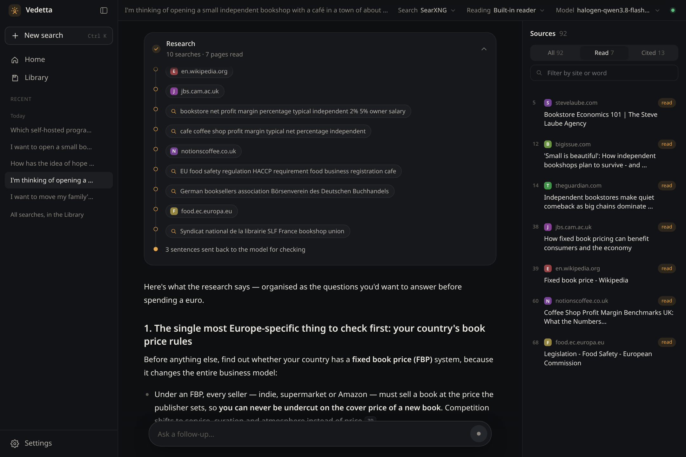

# Vedetta

Vedetta does in-depth research on the web with the language model you choose, and shows you
where what it writes comes from. It is a single, small program written in Go, and it runs on
your computer.

## What it does

You ask a question. The model searches the web, opens pages, reads them whole and, if it
needs to, searches again. When it has written the answer, Vedetta checks it against what was
read and then shows it to you, with its sources.

It is for when you want to know more about something. For example:

- studying a subject: how the idea of hope changes between philosophy and psychology;
- looking around: which programs let you keep the family photos at home, and how they differ;
- preparing a choice: a heat pump or a gas boiler, for a house of a hundred square metres;
- working on an idea: I want to open a small bookshop in my town, what should I look at first?

It does not give you the last word. It brings you the pages to start from, a text that puts
them together, and a way to go and check.

## How it is made

**Light.** The program is about 25 MB and uses about 30 MB of memory when idle. The
interface, the reader for pages and PDFs and the archive of your searches are already
inside. There is no Python, no Node and no separate database to install.

**In pieces.** Vedetta does its own work and leaves the rest to the services you choose.
Each piece can be at home or in the cloud, and you can mix them:

| | At home | In the cloud |
|---|---|---|
| **Model** | Ollama, LM Studio, llama.cpp, vLLM, Lemonade, Halogen, Gufo, DwarfStar | any OpenAI-compatible service |
| **Search** | SearXNG, degoog | Brave, Tavily, Serper, Exa |
| **Reading pages** | built-in reader, Jina Reader, a browser you already have | Firecrawl, Exa |

**Simple.** There is one box where you write the question. Services are switched on in the
settings and chosen from the top bar, even different ones from one search to the next. The
first time it starts, Vedetta looks by itself for the ones you already have.

## Your way of searching

There is no setup that is right for everyone. Some examples:

- **Everything at home.** A model on Ollama, SearXNG or degoog, and the built-in reader. No
  keys, no bills.
- **A mini PC with no graphics card.** Vedetta and SearXNG on the mini PC, the model in the
  cloud with your key.
- **Everything in the cloud.** Brave to search, Firecrawl to read, a pay-per-use model. Only
  Vedetta stays at home.

If tomorrow you change model or search engine, you change that piece and the rest stays as
it is. You also decide in which order the readers are tried, how long pages are remembered
and whether paid services are used as a reserve.

## The experiments

There are quite a few experiments behind Vedetta. The ones that are on are those that seemed
to work best in our tests; the others stayed in the program, turned off. Some are in the
settings, under "Experimental", the others are in the configuration file, where the checks
can also be turned off one by one. The list, with what we saw trying them, is in
[Experiments](guide/experiments.md).

Our choices are a starting point. With another model or other questions you may be better
off with something else: try, and keep the Vedetta that works for you.

## Why there is only one mode

Many tools ask you to choose between a quick, a normal and a deep search. But how much
searching is needed depends on the question, and often you only find out by searching:
sometimes two pages are enough, sometimes it takes twenty. Vedetta leaves it to the model,
which stops when it has enough. For us it also means one road to test properly.

The question matters, then: write everything you want to know. Written out in full, a
question usually makes the model read more than a short one.

The price is some waiting, usually a few minutes. For tomorrow's weather a search engine is
quicker.

## Why you do not choose the sources

There is no menu with web, scientific papers and forums either. A menu like that depends on
which search engines are answering at that moment: if there is none for forums, choosing
"forums" changes nothing, and you do not know it.

If you want scientific studies, a forum or a certain site, write it in the question: the
model takes it into account, and the list of sources shows where it really went.

## The checks

Before you read the answer, Vedetta:

- looks for its numbers and names in what the model saw. Those it does not find go back to
  the model, which verifies them or takes them out;
- opens the cited pages the model did not read and has them compared with the sentence. If
  the page does not say it, the sentence is corrected or the link goes;
- checks that the searches the answer talks about were really made.

Under the answer you find the searches, the pages read and the sentences still to check.
Then you can go on with other questions. The details are in
[How a research works](guide/how-it-works.md).

## The limits

- The checks are about facts: links, numbers, names, cited pages. Judgments, advice and
  comparisons are the model's.
- Errors are still possible: a page can be wrong, and a true number can end up in the wrong
  sentence. If you need the answer for something important, open the sources.
- The result depends on the services you choose, above all on the model. Some read many
  pages, others stop at the first ones.
- What the search does not find, or the reader cannot open, is not in the answer.
- The same question, asked another day, can have a different answer.

Vedetta does not search for images and videos, has no widgets and, for now, does not read
your documents.

## How we tested it

We made more than 1,500 test searches. The questions are always the same, asked again at
every change: some have an answer we already knew, some have none, to see whether the answer
says so. Each time we looked at how many sentences are really on the cited pages, whether the
links lead to pages that were opened, how much is missing of what should be there, how many
errors there are and how much the result changes from one round to the next.

The tests were made mostly at home, with Qwen 3.8 Flash Next on Halogen and a Strix Halo
computer, SearXNG to search, the built-in reader and Jina Reader to read. Some were made with
other models, at home and in the cloud: DeepSeek, Gemma, gpt-oss, Nemotron, LFM. With another
model the results can change a lot.

The numbers of the last rounds, with the errors we found, are in
[Measurements](guide/measurements.md).

## Your data

Searches, settings and keys stay on your computer. There is no account, and nothing is sent
to the project. The cloud services you choose receive what they need: the conversation, the
searches, the addresses to read.

Vedetta opens in the browser, on your phone too, with an access code if you want one. The
interface is in English and Italian; the answer is in the language of the question.

## Installing

You need Docker or Podman, and a model that can use tools. There are two packages: only
Vedetta, if you already have the services, or Vedetta with SearXNG and Jina Reader.

**→ [Installation guide](deploy/README.md)**

## Other pages

| | |
|---|---|
| [Install](deploy/README.md) | the two packages, other devices, updating, removing |
| [Services and settings](guide/settings.md) | models, search, page readers, options |
| [Experiments](guide/experiments.md) | what we tried, what is on and what is off |
| [How a research works](guide/how-it-works.md) | the steps, the checks, the marks in an answer |
| [Measurements](guide/measurements.md) | the last tests, their errors, what we did not measure |
| [Your data](guide/your-data.md) | what Vedetta keeps, and how to delete it |
| [Security](guide/security.md) | who can reach Vedetta, and what it protects from |
| [Development](guide/development.md) | building, testing, where things are |

## What we would like to do next

No dates, and the order can change:

- help with writing a better question, before starting;
- attaching documents, or asking to go deeper into one source;
- pages that stay as long as the conversation they were read in;
- a private search, that leaves nothing behind;
- profiles, for several people with separate searches;
- a documented API, so that other programs can use Vedetta (the base is already there);
- exporting the answer to a document;
- a proper academic search.

If one of these interests you, or one is missing, open an issue.

## The project

Vedetta is a young project. It is made by one person, and the code is written with the help
of an artificial intelligence: which tools, and for what, is in [AI.md](AI.md).

So far it took about 200 hours of work in two months, almost two billion tokens to write and
check the code, and more than 70 hours of a Strix Halo for the tests. The project is in
active development. If you see value in what has been done, we are looking for sponsors and
donations: they help us to go on, to pay for the APIs and, yes, a mortgage too.

**→ [Support Vedetta](https://github.com/sponsors/peppeg)**

If you find an error in an answer, open an issue with the question and what is wrong: that
helps too.

License: [GNU AGPL 3.0](LICENSE).
